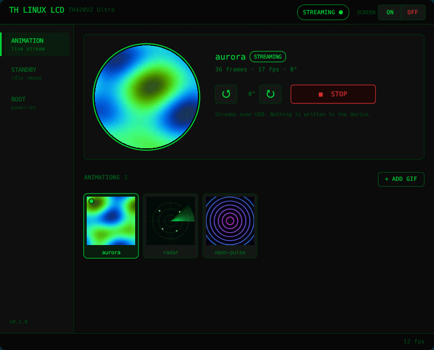

# th-linux-lcd

A Linux app for the LCD screen on the **Thermaltake TH420V2 Ultra** AIO cooler (USB `264a:233c`).
Stream GIFs to the screen, set the standby image, and set the boot animation, with no Windows required.



> [!WARNING]
> Unofficial and unsupported. Not affiliated with Thermaltake. The standby image and boot animation are
> written to the cooler's flash memory using a reverse-engineered protocol. It works on the author's unit,
> but there is no guarantee it works on yours, and a bad write could leave the screen in a bad state.
> Use at your own risk. Streaming GIFs never writes to flash.

## What it does

- **Animation**: stream a GIF to the screen live. It keeps playing while the app is closed and resumes after a reboot.
- **Standby image**: the picture the screen shows when nothing is streaming.
- **Boot animation**: the animation shown when the PC powers on.
- **Screen on/off**, **rotation** in 90° steps, and a **tray icon** that shows the status and opens the app.
- **Stats on the screen**: CPU, coolant and GPU temperature, plus CPU, GPU and RAM load, drawn on top of the streamed GIF. Each one can be switched on or off in the app. There are four styles (Terminal, Retro amber CRT, Heavy metal chrome, Kawaii bubble stickers), and you can adjust the size and position.
- **Plug and play**: unplug the cooler's USB and streaming pauses; plug it back in and it picks up again.

## Install

```bash
git clone https://github.com/klatooine/th-linux-lcd.git
cd th-linux-lcd
bash install.sh
```

The installer works on Arch/CachyOS, Debian/Ubuntu, Fedora and openSUSE. It asks for your sudo password once to install packages and a USB permission rule. It then builds the app, installs it to `~/.local/bin`, and starts the background service and the tray icon.

Run it again to update. To remove everything except your library: `bash install.sh --uninstall`.

On Arch you can also run `makepkg -si` instead, then `systemctl --user enable --now th-linux-lcd`.

## Use

Open **TH Linux LCD** from your app menu, click the tray icon, or run `th-linux-lcd`.

- **Animation**: click **+ ADD GIF**, select it, then **SEND TO LCD**.
- **Standby / Boot**: add an image or GIF, then **WRITE TO LCD**. Don't unplug or power off until the status bar says it's done (up to a minute). To see a new boot animation, power-cycle the cooler.
- Switch tabs with **Ctrl+1 / 2 / 3**.

The cooler has no way to send back what's stored on it, so the app marks the items it last wrote with **ON LCD**.

## Troubleshooting

| Problem | Fix |
|---|---|
| **NO DEVICE** | Unplug and re-plug the cooler's USB cable. If that doesn't help, run `bash install.sh` again to reinstall the USB permission rule. |
| **NO DAEMON** | Click **START DAEMON**, or run `systemctl --user restart th-linux-lcd`. |
| No tray icon | Your panel needs system tray support: waybar's `tray` module, or on GNOME the *AppIndicator* extension. Start it with `th-linux-lcd --tray &`. |
| Standby or boot image looks wrong | Write it again. The official Windows app can also restore it. |
| Anything else | Check the logs: `journalctl --user -u th-linux-lcd -f` |

## How it works

A small background service owns the USB connection and does all the talking to the cooler. The window and the tray icon only send it commands. Everything you import is kept in `~/.local/share/th-linux-lcd/`.

The [docs](docs/) folder covers the USB protocol and how it was reverse-engineered.

## Requirements

`libusb`, `python3` with Pillow, and `zenity`; the installer sets these up. Building needs Rust 1.89 or newer, which the installer also handles.

## License

MIT. The overlay fonts in `assets/fonts/` keep their own licences: Sniglet, VT323 and Metal Mania are under the SIL Open Font License, and Luckiest Guy is under the Apache License 2.0. See each folder.
